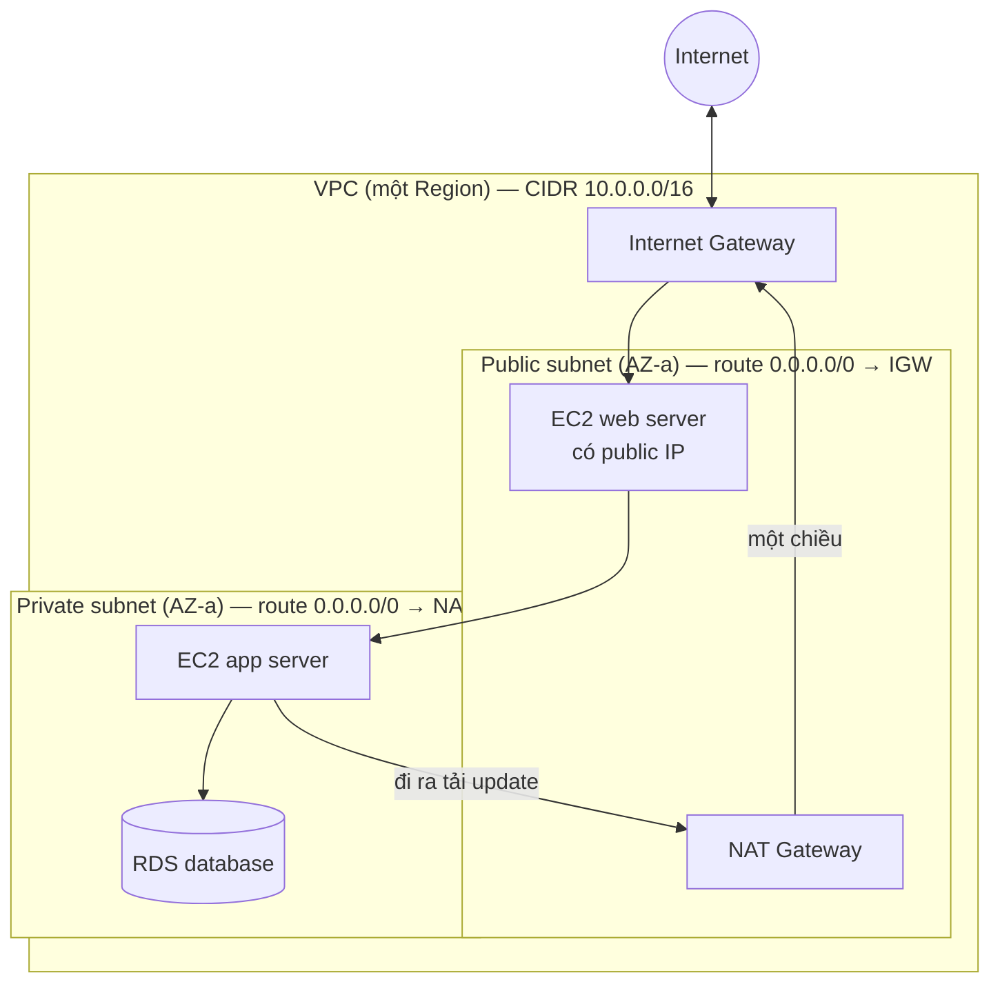

# Network

> **Chốt:** **VPC** là mạng riêng của bạn trong **một Region**; **subnet** nằm trong **đúng
> một AZ**. Public subnet = subnet có route ra **Internet Gateway**. Đó là định nghĩa thật —
> không phải "subnet có tên là public".

## Mục tiêu

Task 3.5 đòi: thành phần của VPC (subnet, gateway), bảo mật trong VPC (**SG ⇄ NACL**), mục
đích của **Route 53**, các **edge service**, và các **tuỳ chọn kết nối** vào AWS.

## Tổng quan

### Các thành phần của VPC

| Thành phần | Phạm vi | Việc của nó |
|---|---|---|
| **VPC** | Một **Region** | Mạng riêng ảo, có dải CIDR riêng |
| **Subnet** | Một **AZ** duy nhất | Chia dải địa chỉ; là đơn vị đặt tài nguyên |
| **Route table** | VPC / subnet | Quyết định gói đi đâu — **đây là thứ làm subnet thành public** |
| **Internet Gateway (IGW)** | VPC | Cho tài nguyên có IP công cộng đi ra và vào internet |
| **NAT Gateway** | Một AZ | Cho tài nguyên trong **private** subnet **đi ra** internet, không cho vào |
| **Virtual Private Gateway** | VPC | Đầu AWS của **Site-to-Site VPN** |
| **VPC Endpoint** | VPC | Gọi service AWS (ví dụ S3) **không qua internet** |
| **VPC Peering / Transit Gateway** | Giữa các VPC | Nối VPC với nhau (Transit Gateway cho nhiều VPC/account) |

**Subnet nằm trong một AZ** là câu có hệ quả lớn nhất ở đây: muốn Multi-AZ thì phải có
**ít nhất một subnet ở mỗi AZ**. Mọi kiến trúc HA trong đề đều bắt đầu từ đó.

**NAT Gateway tính tiền theo giờ và theo GB xử lý**, và **không thuộc Free Tier** — đây là
nguồn hoá đơn bất ngờ phổ biến nhất của người mới.

### Security group ⇄ Network ACL

| | Security group | Network ACL |
|---|---|---|
| Gắn vào | ENI / instance | **Subnet** |
| Rule | **Chỉ allow** | Allow **và deny** |
| Trạng thái | **Stateful** — gói về được tự động cho qua | **Stateless** — phải mở cả hai chiều |
| Đánh giá | Mọi rule, hợp lại | **Theo số thứ tự**, khớp đầu tiên thì dừng |
| Mặc định | Deny hết inbound, allow hết outbound | NACL mặc định allow hết cả hai chiều |

Ba kết luận cho đề:

- **Chặn một IP** → NACL. SG không biểu đạt được "deny".
- **Mở một cổng cho một nhóm máy** → SG, và SG có thể trỏ tới **SG khác** làm nguồn.
- Kết nối "đi được mà không về được" → gần như luôn là **quên outbound rule của NACL**.

Chi tiết WAF, Shield, Network Firewall: [security-components](security-components.md).

### Route 53

DNS được quản, và ba việc nó làm:

| Việc | Nghĩa |
|---|---|
| Đăng ký và host domain | Registrar + authoritative DNS |
| **Routing policy** | simple · weighted · latency-based · failover · geolocation · multivalue |
| **Health check** | Phát hiện endpoint chết và chuyển hướng |

Trong đề: **"chuyển người dùng sang Region khác khi Region chính sập"** → Route 53 **failover
routing** + health check. **"Người dùng tới endpoint gần nhất"** → latency-based routing.

### Hai service edge

| Service | Tối ưu | Giao thức | Dấu hiệu |
|---|---|---|---|
| **Amazon CloudFront** | **Cache** nội dung ở edge location | HTTP/HTTPS | *static content*, *video*, *cache*, *reduce origin load* |
| **AWS Global Accelerator** | **Đường đi mạng** + IP tĩnh toàn cầu | TCP/UDP | *static anycast IP*, *non-HTTP*, *fast regional failover* |

**Amazon API Gateway** cũng nằm trong nhóm Networking của exam guide: nó là cửa vào cho
API — xác thực, throttling, phiên bản — thường đứng trước Lambda.

### Kết nối từ ngoài vào AWS

| Cách | Đặc điểm |
|---|---|
| Internet công cộng | Mặc định, không chuẩn bị |
| **AWS Site-to-Site VPN** | Mã hoá, qua internet, dựng **trong vài giờ** |
| **AWS Direct Connect** | Đường vật lý riêng, băng thông và độ trễ **ổn định**, lắp đặt **nhiều tuần** |
| **AWS Client VPN** | Cho từng người dùng kết nối vào VPC |

Xem thêm [cách triển khai và truy cập](deploy-and-access-methods.md) — ba dấu hiệu quyết
định giữa VPN, Direct Connect và Snow Family.

## Giải thích cặn kẽ

### VPC như một khu đất riêng có hàng rào

Nếu các bảng trên đọc còn trừu tượng, hình dung thế này:

- **VPC** = một **khu đất riêng có hàng rào bao quanh**. Bạn thuê nguyên khu đất trong
  một Region, dựng rào (dải CIDR), và không ai từ ngoài tự nhiên đi vào được.
- **Subnet** = **từng lô đất** bên trong khu. Bạn chia khu đất thành nhiều lô, mỗi lô
  nằm **trong đúng một AZ** — đúng như ngoài đời một lô đất không nằm vắt qua hai mảnh
  đất rời nhau.
- **Public subnet** = lô có **đường ra Internet Gateway**. Có cổng ra mặt đường lớn, xe
  (traffic) đi ra vào tự do (miễn tài nguyên có IP công cộng). Đặt web server, NAT
  Gateway, Load Balancer hướng internet ở đây.
- **Private subnet** = lô **không có đường ra IGW**. Kín hoàn toàn với bên ngoài — đặt
  database, app server nội bộ. Ngoài không gọi vào được.
- **NAT Gateway** = một **cổng một chiều**: lô private cần ra ngoài tải bản cập nhật hệ
  điều hành, gọi API công cộng... thì đi qua cổng này ra internet. Nhưng cổng chỉ cho
  **đi ra**, chiều từ internet **vào thì không** — nên database vẫn kín. NAT Gateway bản
  thân nó **đặt trong public subnet** mới ra được internet.

Điều cốt lõi để không nhầm trong đề: **cái quyết định một subnet là public hay private
không phải cái tên, mà là route table của nó có route `0.0.0.0/0 → igw-...` hay không.**

### Sơ đồ một VPC tối thiểu



Đọc sơ đồ: internet chỉ chạm tới được **IGW → public subnet**. Database trong private
subnet ra ngoài được (qua NAT) nhưng không ai từ ngoài gọi thẳng vào được — chiều vào bị
NAT chặn. Muốn HA thật thì nhân đôi cặp public+private này sang **AZ-b**, vì mỗi subnet
chỉ nằm trong một AZ.

### SG stateful và NACL stateless — ví dụ mở port 443 cho web

Bảng SG ⇄ NACL ở trên nói "SG stateful, NACL stateless". Cụ thể bằng một yêu cầu rất
thường: **cho phép người dùng truy cập web server qua HTTPS (port 443)**.

**Với Security Group** — chỉ cần **một rule inbound**:

```
Inbound:  allow TCP 443 from 0.0.0.0/0
```

Không cần viết rule outbound nào cho traffic trả về. SG **stateful**: khi nó đã cho gói
443 đi vào, nó **tự nhớ** và cho gói trả về (từ server ra client, cổng ephemeral) đi ra —
dù outbound không có rule tương ứng. Đây đúng là nghĩa của "stateful".

**Với NACL** — stateless, phải mở **cả hai chiều bằng tay**:

```
Inbound:   allow TCP 443        from 0.0.0.0/0     (client → server)
Outbound:  allow TCP 1024-65535 to 0.0.0.0/0       (server → client, cổng ephemeral)
```

NACL **không nhớ** kết nối nào cả — mỗi gói được soi độc lập. Nếu quên rule outbound cho
dải cổng ephemeral (`1024-65535`), traffic **đi vào được nhưng trả lời không ra được** →
kết nối treo, không báo lỗi gì. Đây chính là bẫy "đi được mà không về được" ở bảng Bẫy.

Quy tắc dùng chung: **SG là hàng rào mặc định, đủ cho hầu hết tình huống.** Chỉ thêm NACL
khi cần một thứ SG không làm được — chủ yếu là **deny một IP/dải cụ thể** ở cấp subnet.

### Route 53: hiểu routing policy ở mức CLF

Ở mức CLF chỉ cần nhận ra "bài toán nào → policy nào", không cần cấu hình:

| Routing policy | Dùng khi |
|---|---|
| **Simple** | Một domain trỏ tới một resource, không điều kiện |
| **Weighted** | Chia traffic theo tỉ lệ (vd 90/10) — canary, A/B testing |
| **Latency-based** | Đưa user tới Region cho **độ trễ thấp nhất** |
| **Failover** | Region/endpoint chính chết → chuyển sang dự phòng (kèm health check) |
| **Geolocation** | Định tuyến theo **vị trí địa lý** của user (vd EU → server EU vì lý do pháp lý) |
| **Multivalue** | Trả nhiều IP khoẻ mạnh, kiểu round-robin có health check |

### CloudFront: cache ở edge để giảm latency toàn cầu

**CloudFront** là CDN: nó đặt bản sao nội dung ở **edge location** rải khắp thế giới.
Ví dụ cụ thể: website origin đặt ở Region `us-east-1` (Virginia). Một người dùng ở Hà
Nội tải trang:

- **Không có CloudFront:** mỗi request chạy nửa vòng Trái Đất sang Virginia rồi về →
  độ trễ cao, origin gánh toàn bộ tải.
- **Có CloudFront:** lần đầu CloudFront lấy nội dung từ origin và **cache tại edge
  location gần Hà Nội**. Những lần sau phục vụ thẳng từ edge → nhanh hơn nhiều, và origin
  gần như không phải xử lý lại (giảm origin load).

Dấu hiệu nhận ra CloudFront trong đề: *static content, video streaming, cache, giảm tải
cho origin, phục vụ người dùng toàn cầu nhanh hơn, HTTPS cho nội dung web.*

### Direct Connect so với Site-to-Site VPN

Cả hai nối hạ tầng on-premises (data center của bạn) vào AWS, nhưng khác bản chất:

| | Direct Connect | Site-to-Site VPN |
|---|---|---|
| Đường đi | **Đường cáp vật lý riêng** tới AWS | **Qua internet công cộng**, có mã hoá |
| Băng thông, độ trễ | **Ổn định**, nhất quán, không phụ thuộc internet | Dao động theo chất lượng internet |
| Thời gian lắp | **Nhiều tuần** (kéo cáp vật lý qua đối tác) | **Vài giờ** (chỉ cấu hình) |
| Chi phí | Cao hơn, cam kết dài | Thấp, trả theo dùng |
| Khi nào chọn | Tải lớn ổn định, nhạy cảm độ trễ (DB replication, hybrid lâu dài) | Cần kết nối nhanh, rẻ, hoặc làm dự phòng cho Direct Connect |

Thực tế hay kết hợp: dùng **Direct Connect làm đường chính** và **VPN làm backup** — để
Direct Connect không trở thành điểm lỗi đơn khi sợi cáp có sự cố.

## Ví dụ cụ thể

Ba tình huống đúng kiểu câu hỏi CLF-C02, kèm cách suy luận:

<details>
<summary>Tình huống 1 — Security Group hay Network ACL?</summary>

**Đề:** Một web server trong public subnet liên tục bị một địa chỉ IP cụ thể tấn công.
Đội vận hành muốn **chặn riêng địa chỉ IP đó** trong khi vẫn cho mọi người khác truy cập
cổng 443. Nên dùng gì?

**Giải:** **Network ACL**. Security Group **chỉ có rule allow**, không biểu đạt được
"deny một IP cụ thể" — thêm IP đó vào SG cũng không có nghĩa gì. NACL có cả allow lẫn
deny và đánh giá rule theo số thứ tự, nên đặt một rule **deny** nguồn là IP đó với số
thứ tự nhỏ (được xét trước), rồi allow 443 cho phần còn lại ở số lớn hơn. Nhớ: NACL
stateless, nếu có đụng tới chiều trả về thì phải để ý cả outbound.

</details>

<details>
<summary>Tình huống 2 — Giảm độ trễ cho người dùng toàn cầu</summary>

**Đề:** Một trang tin có origin đặt ở một Region duy nhất. Người dùng ở châu Á và châu
Âu phàn nàn ảnh và video tải chậm, đồng thời server origin thường xuyên quá tải vào giờ
cao điểm. Service nào giải quyết cả hai vấn đề với chi phí thấp nhất?

**Giải:** **Amazon CloudFront**. Nó cache nội dung tĩnh (ảnh, video) ở edge location gần
người dùng → giảm độ trễ cho user châu Á/châu Âu, đồng thời phục vụ từ cache nên
**origin đỡ tải hẳn**. Không cần đổi Region hay nhân bản hạ tầng. (Bẫy: nếu đề nói giao
thức **không phải HTTP/HTTPS** hoặc cần **IP tĩnh toàn cầu** thì mới là Global
Accelerator.)

</details>

<details>
<summary>Tình huống 3 — Kết nối on-premises ổn định, băng thông cao</summary>

**Đề:** Một ngân hàng cần đồng bộ dữ liệu khối lượng lớn giữa data center on-premises và
AWS **liên tục, độ trễ thấp và ổn định**, không chấp nhận dao động của internet công
cộng. Dự án dài hạn. Nên chọn kết nối nào?

**Giải:** **AWS Direct Connect** — đường cáp vật lý riêng cho băng thông và độ trễ nhất
quán, phù hợp tải lớn ổn định dài hạn. (Nếu đề nhấn "cần ngay trong vài giờ" hoặc "chi
phí thấp, tạm thời" thì đáp án đổi thành **Site-to-Site VPN**. Thực tế nên có VPN dự
phòng để Direct Connect khỏi thành điểm lỗi đơn.)

</details>

## Bẫy trong đề

| Bẫy | Vì sao sai |
|---|---|
| Dùng **SG** để chặn một IP tấn công | SG chỉ có allow ⇒ **NACL** |
| Quên rule outbound của NACL | NACL stateless ⇒ kết nối treo, không báo lỗi gì |
| Cho rằng một subnet trải trên nhiều AZ | Một subnet thuộc **đúng một** AZ |
| Dùng **IGW** cho private subnet ra internet | Đó là **NAT Gateway** (private không có IP công cộng) |
| Cho rằng NAT Gateway miễn phí | Tính theo giờ + theo GB, **không thuộc Free Tier** |
| Chọn **CloudFront** cho giao thức TCP/UDP không phải web | Đó là **Global Accelerator** |
| Chọn **Direct Connect** để "nối hai VPC" | Đó là **VPC Peering** hoặc **Transit Gateway** |
| Truy cập S3 từ private subnet bằng cách mở NAT | Rẻ và kín hơn: **VPC Endpoint** |

## Đánh đổi

| Quyết định | Được | Mất |
|---|---|---|
| Private subnet + NAT Gateway | Tài nguyên không phơi ra internet | Phí NAT theo giờ và theo GB; NAT trong một AZ là một điểm lỗi |
| VPC Endpoint thay NAT cho S3 | Không qua internet, giảm phí data transfer | Phải cấu hình thêm; endpoint interface có phí riêng |
| NACL ngoài SG | Thêm một hàng rào cấp subnet | Stateless ⇒ dễ tự chặn mình; rule đánh số khó đọc |
| Direct Connect | Băng thông, độ trễ ổn định | Phí cố định, lắp lâu; cần VPN dự phòng để khỏi thành điểm lỗi |
| Transit Gateway thay nhiều peering | Một chỗ định tuyến, đỡ rối khi nhiều VPC | Có phí theo attachment và theo lượng dữ liệu |

## Related Topics

- [Global infrastructure](global-infrastructure.md) — subnet ⇄ AZ, và vì sao Multi-AZ bắt đầu từ subnet
- [Thành phần bảo mật](security-components.md) — SG, NACL, WAF, Shield xếp thành bốn tầng
- [Compute](compute.md) — ELB phân tải qua các subnet ở nhiều AZ
- [Cách triển khai và truy cập](deploy-and-access-methods.md) — VPN, Direct Connect, hybrid
- [Case study: security group không chặn được một IP](../case-studies/security-group-khong-chan-duoc-ip.md)
- [AWS · Foundations](../index.md)
